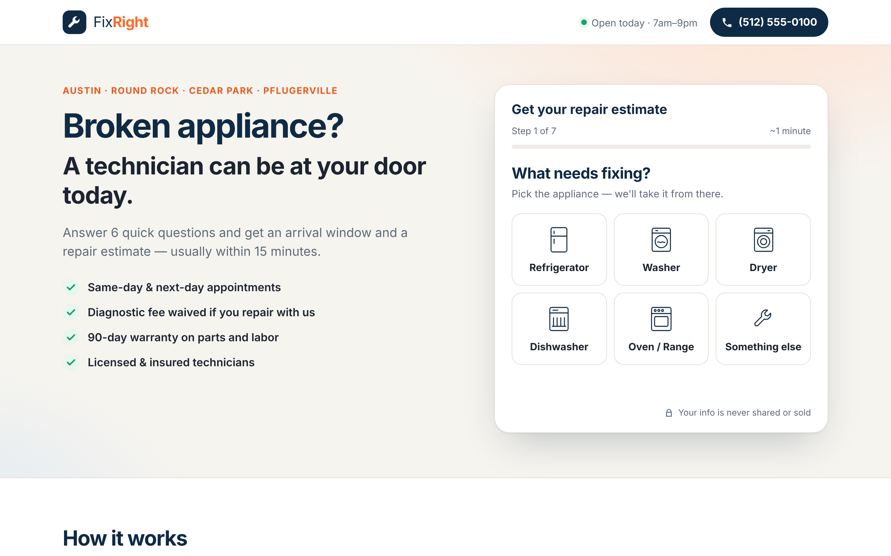
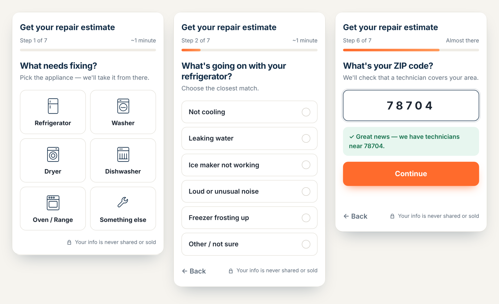
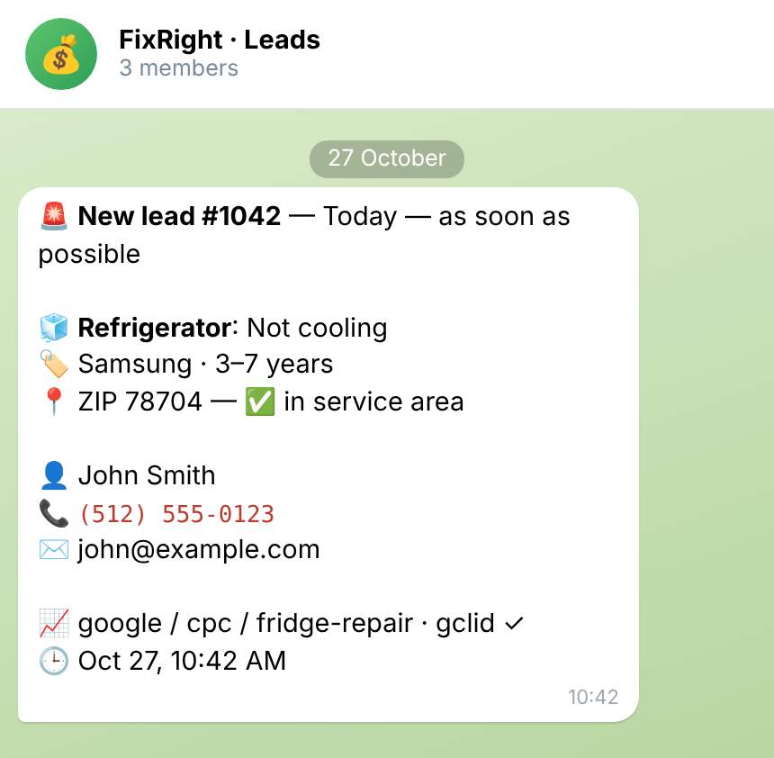
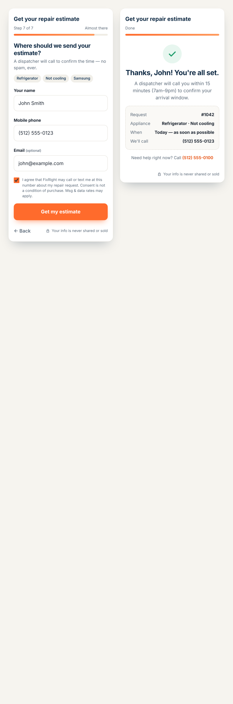

# Квіз-лендинг для збору заявок → Telegram + Google Sheets

Лендинг-квіз англійською для сервісу ремонту побутової техніки в США (вигадана компанія FixRight, Остін, Техас). Клієнт відповідає на 6 запитань і залишає телефон. Заявка одразу приходить у Telegram-групу диспетчерів і записується в Google-таблицю разом з UTM-мітками з реклами.



<p>


</p>



## Як працює

1. **Квіз з 7 кроків:** техніка → несправність (своя для кожної техніки) → бренд → вік → коли потрібен майстер → ZIP-код → контакти.
2. **ZIP-код перевіряється одразу.** Якщо адреса поза зоною обслуговування, заявку все одно приймаємо, але в Telegram вона позначена ⚠️.
3. **Заявка спершу зберігається в SQLite, потім іде в Telegram і Google Sheets.** Якщо Telegram недоступний, бот робить кілька повторних спроб, а після перезапуску сервер дошле все, що не дійшло.

## Що всередині

**Фронтенд** (чистий HTML/CSS/JS, без фреймворків)
- Адаптивний: на телефоні квіз — перше, що бачить користувач. Плитки з іконками, автоперехід після вибору, кнопка «Назад».
- Маска телефону `(512) 555-0123`, перевірка полів до відправки, зрозумілі помилки біля кожного поля.
- Згода на дзвінки та SMS (TCPA-формулювання для США).
- Прогрес зберігається в `sessionStorage`: якщо сторінку випадково оновити, відповіді не губляться.
- UTM-мітки та `gclid` з посилання реклами передаються разом із заявкою.
- Події `quiz_step` і `lead_submitted` у `dataLayer` для Google Tag Manager / конверсій Google Ads (видно, на якому кроці відвалюються люди).
- Варіанти відповідей приходять з `/api/quiz`, тому сервер і фронтенд не розходяться.

**Бекенд** (FastAPI)
- **Сувора валідація:** американський номер за правилами NANP, ZIP, email; несправність має відповідати обраній техніці.
- **Антиспам без капчі:**
  - підписаний HMAC-токен форми: бот, який шле POST одразу, не пройде перевірку мінімального часу заповнення;
  - приховане поле-пастка (honeypot);
  - ліміт заявок з однієї IP за годину.
- **Без дублікатів:** повторна відправка з того самого номера протягом 30 хвилин не створює другу заявку і не шле друге повідомлення.
- **Повідомлення в Telegram:** коли потрібен майстер, техніка, несправність, бренд, зона, контакти, джерело реклами.
- **Google Sheets:** окремий рядок на кожну заявку, включно з UTM і gclid (для імпорту офлайн-конверсій).

## Запуск

```bash
python -m venv .venv
.venv\Scripts\activate            # Linux/macOS: source .venv/bin/activate
pip install -r requirements.txt
copy .env.example .env            # токен бота, ID чату, ZIP-коди зони
uvicorn app.main:create_app --factory --reload
```

Відкрити http://127.0.0.1:8000

### Docker

```bash
docker compose up -d --build
```

### Налаштування (`.env`)

| Змінна | Що означає |
|---|---|
| `TELEGRAM_BOT_TOKEN`, `TELEGRAM_CHAT_ID` | куди слати заявки (бота треба додати в групу) |
| `SERVICE_ZIPS` | зона обслуговування: `787*,78610` (префікси з `*` або повні коди) |
| `SHEET_ID`, `GOOGLE_CREDENTIALS` | Google Sheets через сервісний акаунт (необов'язково) |
| `SECRET_KEY` | ключ для підпису токена форми |
| `RATE_LIMIT_PER_HOUR` | скільки заявок з однієї IP за годину |
| `TIMEZONE` | часовий пояс бізнесу для повідомлень |
| `TRUST_PROXY` | `1`, якщо сайт стоїть за nginx/Cloudflare |

Тексти, ціни й варіанти відповідей змінюються в `web/index.html` і `app/quiz.py`.

## Структура

```
app/
├── main.py      # FastAPI: сторінка, /api/quiz, /api/zip, /api/token, /api/leads
├── quiz.py      # варіанти відповідей (одне джерело для фронтенду і перевірки)
├── models.py    # валідація заявки, нормалізація телефону
├── antispam.py  # токен форми, ліміт на IP
├── storage.py   # SQLite
├── notify.py    # Telegram, Google Sheets, повторні спроби
└── config.py
web/             # index.html, styles.css, quiz.js
tests/test_api.py
```

## Тести

```bash
python -m pytest
```

12 тестів:
- нормалізація телефонів, токен і ліміти;
- успішна заявка: збережена, текст у Telegram, рядок у таблиці;
- помилки валідації;
- honeypot і «занадто швидка» форма;
- дублікати й ліміт на IP;
- падіння Telegram з дозавантаженням після перезапуску.

Telegram підмінено через `httpx.MockTransport`. Фронтенд додатково пройдено в Playwright: весь квіз на мобільному, валідація форми, маска телефону, передача UTM. Скріншоти зроблені під час цього прогону.

**Технології:** Python 3.10+, FastAPI, Pydantic 2, httpx, SQLite, gspread, HTML/CSS/JS, Docker.
